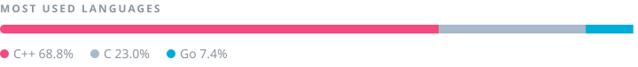

<h1 align="center">Caio Paranaiba</h1>

Computer Science @ PUC Goiás · Competitive Programmer

I came to Computer Science from Physics, and competitive programming is what made it all make sense: a problem, a time limit, a complexity analysis. I like building my own tools, tweaking my Arch setup, and on weekends I'm the game master of an RPG table.

<table>
<tr>
<td width="50%" valign="top">
<b><a href="https://github.com/CaioParanaiba/maratona-lib">maratona-lib</a></b> 
My contest library and printed notebook. 
C++ · competitive programming
</td>
<td width="50%" valign="top">
<b><a href="https://github.com/CaioParanaiba/problem-solving">problem-solving</a></b> 
Accepted solutions from CF, AtCoder and Beecrowd. 
C++ · notes in <a href="https://github.com/CaioParanaiba/CompetitiveNotes">CompetitiveNotes</a>
</td>
</tr>
<tr>
<td width="50%" valign="top">
<b><a href="https://github.com/CaioParanaiba/neivi">neivi</a></b> 
Tasks and habits in the terminal, on todo.txt. 
Go · personal project
</td>
<td width="50%" valign="top">
<b><a href="https://github.com/CaioParanaiba/persistent-scoreboard">persistent-scoreboard</a></b> 
ICPC scoreboard engine with binary-file storage. 
C · university project
</td>
</tr>
</table>

